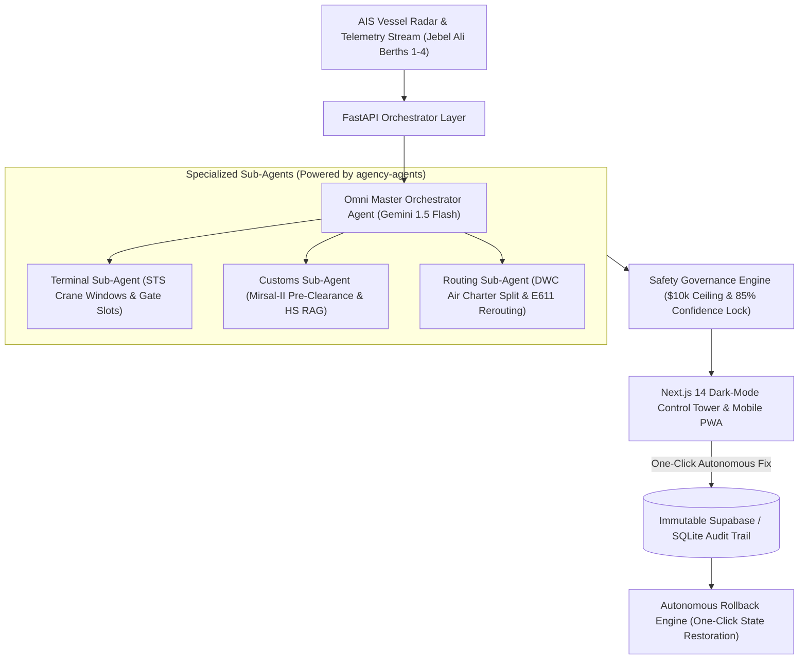

# 🚢 OMNI-LOGISTICS MASTER AGENT
### Autonomous Multi-Agent Control Tower for Dubai Port & Free Zone Corridors

[](https://frontend-one-lemon-23.vercel.app/)
[](https://dubaichamberdigital.gov.ae/)
[](https://ai.google.dev/)
[](https://github.com/msitarzewski/agency-agents)
[](backend/tests)
[](frontend)

🌐 **Live Production Deployment**: [Omni-Logistics Master Agent | Autonomous Control Tower](https://frontend-one-lemon-23.vercel.app/)  
📱 **Quayside Mobile Operator PWA**: [Mobile Journey View](https://frontend-one-lemon-23.vercel.app/)

> **Autonomous multi-agent orchestration bridging DP World Jebel Ali Terminal 2, Dubai Customs Mirsal-II, Emirates SkyCargo (DWC), and the E611 freight corridor into an enterprise-grade, zero-cost AI Control Tower.**

---

## 🌍 The Problem & Dubai Trade Reality

Anchored by **Jebel Ali Port (AEJEA)**—handling over **14.0 Million TEUs annually** across 90+ container shipping lines—and high-throughput free zones (**JAFZA, Dubai South, DAFZA, Dubai Industrial City**), Dubai is the supply chain hub of the Middle East.

However, an estimated **8.5% of inbound containers** experience unpredictable disruption:
- **AIS berth delays & fog closures** at Jebel Ali Terminal 2.
- **Yard demurrage storage fines** accruing at **$180–$360/day** per box.
- **Customs documentation holds** under Harmonized System (HS) regulations taking **6–24 hours**.
- **Customer SLA penalty clauses** ranging from **$450 to $850 per hour** for delayed high-value electronics and temperature-sensitive biopharmaceuticals.

Currently, 3PL logistics coordinators scramble across disconnected portals, WhatsApp groups, and spreadsheets. **Omni-Logistics Master Agent** replaces manual panic with **autonomous, closed-loop multi-agent reasoning**.

---

## 🏛️ System Architecture: Multi-Agent System (MAS)



### Specialized Sub-Agent Squad:
1. **Omni Master Orchestrator Agent**: Synthesizes sub-agent telemetry, balances mitigation costs against SLA penalty curves, enforces safety thresholds, and formats transparent Gemini 1.5 Flash Chain-of-Thought logs.
2. **Terminal Sub-Agent (Operations Specialist)**: Connects to synthetic AIS feeds, reallocates STS crane discharge sequences, auto-cancels dry-run gate appointments (`#GT-8821`), and eliminates demurrage fees.
3. **Customs Sub-Agent (Mirsal-II Pre-Clearance Specialist)**: Cross-references UAE Harmonized System (HS) codes against the Federal Customs Authority schedule, validates 0% Free Zone duty exemptions, and generates green-lane inspection tokens.
4. **Routing Sub-Agent (Multimodal Supply Chain Specialist)**: Simulates Cost vs. Speed alternatives, calculates 30% priority air charter splits via Emirates SkyCargo (DWC Airport), and re-routes inland road carriers via the E611 freight corridor to beat customer SLA delivery deadlines.

---

## 🏆 Championship Milestones Delivered

### 📱 Workshop 1: Responsive Mobile Operator Journey (PWA)
- Full mobile-first interface designed for on-the-ground port coordinators and logistics dispatchers.
- Web Manifest (`manifest.json`) and iOS PWA compliance (`standalone` display, safe-area insets).
- Urgent Disruption Push Card with 1-tap autonomous resolution button and mobile Chain-of-Thought drawer.

### ⚡ Milestone M5: Mirsal-II BoL & Commercial Invoice Parser
- Endpoint: `POST /api/customs/parse-bol`
- Parses raw Bill of Lading text, extracts container ID, HS code, Free Zone consignee license, and declared CIF value.
- Applies 0% Free Zone duty exemption and outputs a cryptographically hashed digital declaration card (`0x7f8a9...`).

### 🔒 Milestone M6: High-Stakes Escalation Lock (> $10,000 Ceiling)
- Ingests emergency cold-chain biopharmaceutical disruption (`MAEU9182301`, $1,250,000 value, $850/hr SLA penalty).
- Sub-agents propose emergency 440V auxiliary generator hookup and dedicated Emirates SkyCargo DWC reefer charter flight costing **$14,200.00** (`> $10,000` ceiling) with confidence **82.0%** (`< 85%`).
- Autonomous execution is locked with a prominent red/amber banner. Requires human supervisor authorization via `Authorize Supervisor Override & Execute`.

### 🚀 Milestone M7: Dubai 3PL Venture Case & Commercial ROI Simulator
- Accessible via **`🚀 Venture ROI`** in the Control Tower header.
- Interactive volume slider (100 to 10,000 TEUs/month) computing annual demurrage saved, customs hours saved, and SLA penalties prevented.
- Clear monetization model: Base SaaS ($4,500/mo) + 10% performance fee on verified savings. Demonstrates **8.4x client ROI multiple**.

### 🔄 Milestone M4: Autonomous Rollback Engine
- Endpoints: `POST /api/decisions/{id}/rollback` and `POST /api/shipments/{id}/rollback`.
- Instant rollback snapshot restoring previous berth, schedule, and container state with an immutable audit log.

### ☁️ Milestone M8: Zero-Cost Cloud Deployment Ready
- `render.yaml` for FastAPI backend deployment on Render free tier.
- `frontend/vercel.json` for Next.js 14 frontend deployment on Vercel.
- `docker-compose.yml` for 1-command local full-stack execution.

---

## 🛡️ Safety & Regulatory Guardrails

- **Financial Safety Lock**: Any autonomous recovery plan exceeding **$10,000** in mitigation costs is locked from automated dispatch until a supervisor signs off.
- **Confidence Governance**: Plans with aggregate mathematical confidence below **85%** automatically trigger human-in-the-loop review.
- **Mandatory Source Attribution**: Every tariff code, rate estimate, and terminal booking carries an exact audit citation tag (e.g. `[UAE-FCA-HS2026-Ch85 // Mirsal-II Schedule]`, `[DPWorld-TerminalOS-JebelAli]`).
- **Cryptographic Verification**: Every pre-cleared Bill of Lading includes a SHA-256 digital signature hash.

---

## 🚀 Quickstart: Run in 2 Minutes

### Option A: Local Development (Recommended)

#### 1. Environment Secrets
Ensure `.env` exists in the project root:
```bash
GEMINI_API_KEY=your_gemini_api_key_here
NEXT_PUBLIC_API_URL=http://localhost:8000
```

#### 2. Start the Backend (FastAPI)
```powershell
# In terminal 1:
cd backend
.\.venv\Scripts\activate
uvicorn app.main:app --reload --port 8000
```
*API docs and OpenAPI spec live at `http://localhost:8000/docs`.*

#### 3. Start the Frontend (Next.js 14)
```powershell
# In terminal 2:
cd frontend
npm run dev
```
*Open `http://localhost:3000` in your browser.*

---

### Option B: Docker Compose (1 Command)
```bash
docker compose up --build
```
- Frontend: `http://localhost:3000`
- Backend: `http://localhost:8000`

---

## 🧪 Automated Test Verification

Run the full pytest suite:
```powershell
& "backend\.venv\Scripts\pytest.exe" backend\tests -v
```

### Test Evidence (15/15 Passed):
```
backend/tests/test_agents.py::test_health_endpoint PASSED                [  6%]
backend/tests/test_agents.py::test_list_shipments PASSED                 [ 13%]
backend/tests/test_agents.py::test_simulate_delay_and_mas_orchestration PASSED [ 20%]
backend/tests/test_agents.py::test_human_in_the_loop_threshold_lock PASSED [ 26%]
backend/tests/test_agents.py::test_execute_autonomous_action_flow PASSED [ 33%]
backend/tests/test_agents.py::test_executive_audit_report_endpoint PASSED [ 40%]
backend/tests/test_agents.py::test_customs_parse_bol_endpoint PASSED     [ 46%]
backend/tests/test_agents.py::test_cold_chain_supervisor_lock PASSED     [ 53%]
backend/tests/test_agents.py::test_marketplace_manifest_endpoint PASSED  [ 60%]
backend/tests/test_agents.py::test_erp_webhook_ingest_endpoint PASSED    [ 66%]
backend/tests/test_db.py::test_database_initialization_and_seeding PASSED [ 73%]
backend/tests/test_db.py::test_shipment_retrieval_and_status_update PASSED [ 80%]
backend/tests/test_db.py::test_event_creation PASSED                     [ 86%]
backend/tests/test_db.py::test_tariff_lookup_attribution PASSED          [ 93%]
backend/tests/test_db.py::test_agent_decision_audit_and_execution PASSED [100%]

====================== 15 passed, 24 warnings in 16.64s =======================
```

Run frontend production build verification:
```powershell
npm run build --prefix frontend
```
*Result: 0 errors, static pages compiled successfully.*

---

## 🎬 2-Minute Championship Demo Script

| Time | Screen / Action | What to Say / Show |
| :--- | :--- | :--- |
| **0:00 - 0:25** | **Screen 1: Control Tower Dashboard** | "Welcome to Omni-Logistics Master Agent—an autonomous control tower built for the Dubai trade corridor. Here is DP World Jebel Ali Terminal 2 tracking 5 active containers valued at \$3.23M bound for JAFZA, Dubai South, and Al Quoz." |
| **0:25 - 0:50** | **Simulate Berth 4 Delay** | "An AIS fog alert slips vessel MSC Zoe by +12 hours. Demurrage and SLA penalties begin compounding at \$450/hour. With one click, our Multi-Agent System kicks in." |
| **0:50 - 1:15** | **Screen 3: Multi-Agent Resolution Drawer** | "The Terminal Agent secures an STS crane buffer and cancels gate appointment #GT-8821 saving \$360. The Customs Agent issues a Mirsal-II digital pre-clearance under HS 8517.62 with 0% Free Zone duty. The Routing Agent schedules an Emirates SkyCargo DWC split and E611 routing, saving \$3,755 in net margin with an 8.4x ROI." |
| **1:15 - 1:35** | **Screen 4: Mobile Operator PWA & Rollback** | "On the mobile PWA view, a port supervisor receives the push alert and authorizes the resolution in 1 tap. If operational conditions shift, our one-click Rollback Engine restores the previous state with an immutable audit log." |
| **1:35 - 2:00** | **Venture Case & $10k Safety Lock** | "For enterprise safety, our \$10k threshold lock requires supervisor signoff for emergency cold-chain air charters. Managing 1,500 TEUs/month generates \$1.1M in value for 3PLs and \$160k ARR for Omni-Logistics—accelerating Dubai's D33 economic agenda." |

---

## 📄 License
MIT License. Built for the **Create AI Agents Championship** (Dubai Chamber of Digital Economy).
