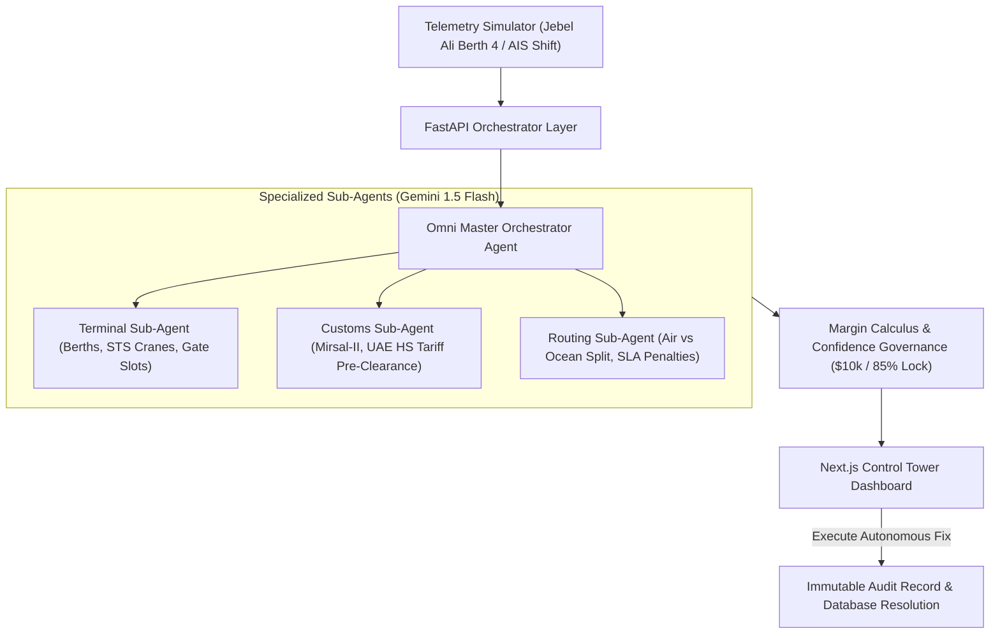

# Omni-Logistics Master Agent (Autonomous Control Tower)

> **Unifying Terminal Workflows, Customs Pre-Clearance, Proactive Disruption Routing, and Real-Time Margin Optimization into a Single Zero-Cost AI Orchestrator.**

Anchored by world-scale port infrastructure such as **Jebel Ali Port (AEJEA)** and expansive free zones (**JAFZA, Dubai South, DAFZA**), Dubai operates as a premier global logistics hub. Converting high-velocity operational telemetry into governed actions requires moving beyond fragmented human handoffs.

The **Omni-Logistics Master Agent** operates as an Autonomous Control Tower atop enterprise logistics systems. Under the hood, it executes as a Multi-Agent System (MAS)—a Master Orchestrator delegating specialized tasks to a Terminal Agent, Customs Agent, and Routing Agent powered by **Gemini 1.5 Flash**.

---

## 🛠️ Zero-Cost Open-Source Stack ($0/Mo MVP)
- **Frontend**: Next.js 14 (App Router, TailwindCSS, TypeScript, Lucide Icons)
- **Backend**: Python 3.12 + FastAPI (Pydantic v2 schemas)
- **Reasoning Engine**: Google Gemini 1.5 Flash via `google-genai` SDK
- **Database & Audit**: Supabase PostgreSQL compatible with zero-setup local SQLite fallback

---

## 🧠 Multi-Agent Architecture (MAS)



### The 4 Sub-Agents:
1. **Omni Master Orchestrator Agent**: Central brain that ingests disruption events, coordinates sub-agents, calculates net financial margin impact, enforces confidence governance thresholds, and formats Chain-of-Thought logs.
2. **Terminal Sub-Agent**: Tracks AIS vessel ETA shifts, reschedules crane availability windows at Jebel Ali Terminal 2, cancels empty truck gate appointments, and eliminates demurrage fees.
3. **Customs Sub-Agent**: Pre-clears Bills of Lading (BoL) under UAE Free Zone exemptions (Mirsal-II), cross-checks Harmonized System (HS) tariff codes, and issues green-lane inspection tokens before docking.
4. **Routing Sub-Agent**: Runs Cost vs. Speed multimodal simulations, performs dynamic air freight cargo splits via Emirates SkyCargo (DWC Airport) for high-value items, and reroutes inland road carriers via the E611 freight corridor to beat customer SLA penalty deadlines.

---

## 🛡️ Data Governance & Safety Guardrails

- **Mandatory Source Attribution**: Every tariff code, rate estimate, and terminal booking carries an exact audit citation tag (e.g. `[Source: Mock-UAE-Tariff-2026-Ch85]`, `[Source: Sim-AIS-JebelAli-Berth04]`).
- **Safety Financial Threshold**: If operational cost impact exceeds **\$10,000**, autonomous execution is **locked**. The plan outputs `"I'm not sure — Human Review Required"` and routes the ticket to a human supervisor with a one-click rollback snapshot.
- **Confidence Threshold**: If aggregate mathematical confidence falls below **85%**, one-click execution is locked to prevent autonomous hallucinations.
- **Auditability & Chain-of-Thought (CoT)**: Every resolution card in the Control Tower includes an expandable drawer exposing the exact prompts, sub-agent recommendations, and variables used by Gemini 1.5 Flash.

---

## 🚀 Quickstart Guide

### Prerequisites
- Node.js 18+ (Tested on Node v22.14)
- Python 3.11 or 3.12
- Google AI Studio API Key (`GEMINI_API_KEY`)

### 1. Environment Secrets
Copy `.env.example` to `.env` or verify root `.env`:
```bash
GEMINI_API_KEY=your_gemini_api_key_here
NEXT_PUBLIC_API_URL=http://localhost:8000
```

### 2. Start the Backend (FastAPI)
```bash
# Navigate to backend and activate virtual environment
cd backend
.\.venv\Scripts\activate

# Run FastAPI server on port 8000
uvicorn app.main:app --reload --port 8000
```
Backend runs at `http://localhost:8000`. API docs available at `http://localhost:8000/docs`.

### 3. Start the Frontend (Next.js 14)
In a separate terminal:
```bash
cd frontend
npm run dev
```
Open your browser to `http://localhost:3000`.

---

## 🧪 Running Automated Tests
```bash
# Run backend pytest suite
& "backend\.venv\Scripts\pytest.exe" backend\tests -v
```
All 10 unit and integration tests verify:
- Database table creation & synthetic data seeder
- Anomaly delay injection & AIS telemetry updates
- Multi-agent orchestration and Gemini 1.5 Flash synthesis
- Human-in-the-loop safety threshold locks
- Autonomous execution write-back and immutable audit records
